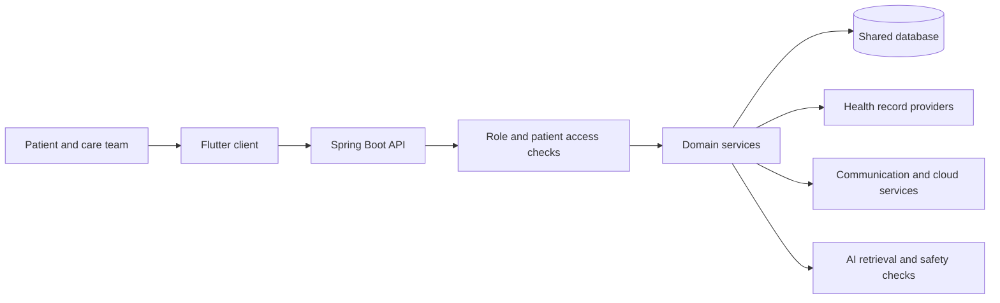
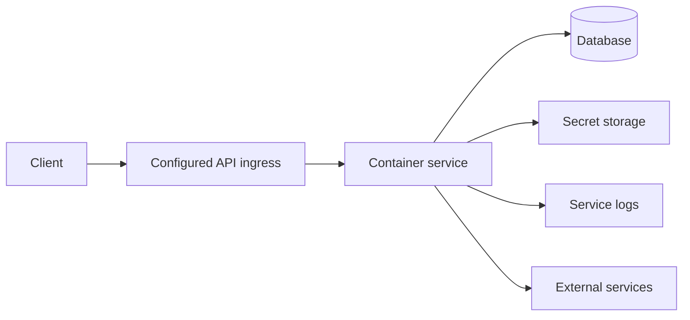

# CareConnect — Repository Technical Design

**Revision:** M4 review edition, October 27, 2026.
**Source baseline:** `team-c-develop` at `d730b752e125cbca09a11c742db66a01b3347cf4`.
**Document status:** Proposed technical design update for team review; approval and release sign-off remain separate.
**Prepared for:** CareConnect, SWEN 670. Team language describes shared system behavior, not individual credit.

This document follows the course TDD template's 18 sections. Code links are pinned to the reviewed commit. “Implemented” means source was inspected. It does not mean deployed, accepted, or tested on this commit. Existing course documents remain intact.

Companion: [Team C technical design](../team-c/TEAM_C_TECHNICAL_DESIGN_M4.md).

## 1. Introduction
This TDD gives the cohort a current view of the shared system and its main design boundaries. It supports code review, integration, test planning, and handoff. It is not a release certificate.

The scope is the repository-wide architecture, with deeper source review of Team C and the shared services it uses. Other teams must confirm their detailed contracts and delivery status. The inherited [01_Technical_Design_Document_TeamE_tracked.docx](https://github.com/umgc/2026_fall_careconnect/blob/d730b752e125cbca09a11c742db66a01b3347cf4/docs/01_Technical_Design_Document_TeamE_tracked.docx) remains a historical design source; this update does not replace its tracked review record.

Terms: FHIR is the health-record exchange format. SMART is the app sign-in framework used with FHIR. OAuth issues access tokens. PKCE binds a sign-in request to its callback. DTO means the data shape passed across a boundary. RTL means right-to-left text.

## 2. System Overview
CareConnect helps patients and care teams manage health information, care tasks, and communication. The code has patient, caregiver, family, and admin paths. Access depends on both the caller's role and the patient relationship; each route needs its own review.

The primary client is Flutter. A Spring Boot backend exposes HTTP APIs and stores shared data. Provider adapters connect outside systems. The repository also includes a mobile web preview, cloud templates, quality tools, and identity-reconciliation work. Those folders are not proof that every component is deployed.

Constraints include health-data privacy, uneven provider support, service credentials, test-only data for demonstrations, and cross-team contract approval. Sources: [controller](https://github.com/umgc/2026_fall_careconnect/blob/d730b752e125cbca09a11c742db66a01b3347cf4/backend/core/src/main/java/com/careconnect/controller), [service](https://github.com/umgc/2026_fall_careconnect/blob/d730b752e125cbca09a11c742db66a01b3347cf4/backend/core/src/main/java/com/careconnect/service), [SecurityConfig.java](https://github.com/umgc/2026_fall_careconnect/blob/d730b752e125cbca09a11c742db66a01b3347cf4/backend/core/src/main/java/com/careconnect/config/SecurityConfig.java).

## 3. Architecture

The design groups controllers, services, repositories, and models within the backend. Provider adapters keep source-specific tokens, IDs, and FHIR handling out of the UI. The database is shared across domain features, so schema and deletion changes need joint review.

Cloud templates describe a container service, network, database, and secrets. This is a logical deployment view, not a verified live topology:

Review scaling, API ingress choices, and local sign-in state before enabling multiple replicas. Sources: [cloudformation-fargate](https://github.com/umgc/2026_fall_careconnect/blob/d730b752e125cbca09a11c742db66a01b3347cf4/cloudformation-fargate), [CernerAuthStateStore.java](https://github.com/umgc/2026_fall_careconnect/blob/d730b752e125cbca09a11c742db66a01b3347cf4/backend/core/src/main/java/com/careconnect/service/ehr/CernerAuthStateStore.java).

## 4. Technology Stack
| Layer | Observed choice | Design effect |
|---|---|---|
| Client | Flutter; Dart constraint >=3.5 and <4 | Shared UI and generated locale resources |
| Backend | Java 17; Spring Boot 3.4.5; Maven | HTTP services, validation, persistence, tests |
| Data | Relational entities; PostgreSQL-specific JSONB/schema work | Real PostgreSQL checks remain distinct from H2 tests |
| Cloud | AWS container/network/data templates | Environment setup must be verified before release |
| Build and quality | GitHub Actions, Maven and Flutter checks, scanner policy | A successful job must be read with its policy mode |

Sources: [pom.xml](https://github.com/umgc/2026_fall_careconnect/blob/d730b752e125cbca09a11c742db66a01b3347cf4/backend/core/pom.xml), [pubspec.yaml](https://github.com/umgc/2026_fall_careconnect/blob/d730b752e125cbca09a11c742db66a01b3347cf4/frontend/pubspec.yaml), [db](https://github.com/umgc/2026_fall_careconnect/blob/d730b752e125cbca09a11c742db66a01b3347cf4/backend/core/src/main/resources/db), [workflows](https://github.com/umgc/2026_fall_careconnect/blob/d730b752e125cbca09a11c742db66a01b3347cf4/.github/workflows), [policy.yaml](https://github.com/umgc/2026_fall_careconnect/blob/d730b752e125cbca09a11c742db66a01b3347cf4/quality/ci/gate/policy.yaml). Version values describe this snapshot, not a promise about installed or deployed versions.

## 5. Detailed Design of Delivered Features
The following is a source inventory. It is not a pass/fail list for the full product.

| Feature group | Main responsibility | Boundary to review |
|---|---|---|
| Identity and care links | Sign-in, users, patient/caregiver links, invites | Role, relationship, and session/token rules |
| Health data | Provider connect, fetch, map, and local record storage | Identity, source provenance, consent, refresh, purge |
| Care workflows | Medications, check-ins, visits, EVV and schedules | Time zones, validation, patient scope, submission state |
| Communication | Messages, notifications, calls and summaries | Recipient rights, media lifecycle, delivery failures |
| Documents and billing | Files, OCR, invoices and related processing | File access, extraction errors, retention |
| AI and review | Record-grounded answers and held-output review | Minimum data use, citations, withholding, reviewer rights |
| Admin and telemetry | User/admin operations and operational signals | Public exemptions, permissions, sensitive log content |

Use [controller](https://github.com/umgc/2026_fall_careconnect/blob/d730b752e125cbca09a11c742db66a01b3347cf4/backend/core/src/main/java/com/careconnect/controller), [service](https://github.com/umgc/2026_fall_careconnect/blob/d730b752e125cbca09a11c742db66a01b3347cf4/backend/core/src/main/java/com/careconnect/service), and [model](https://github.com/umgc/2026_fall_careconnect/blob/d730b752e125cbca09a11c742db66a01b3347cf4/backend/core/src/main/java/com/careconnect/model) as the source catalog. Team-specific design details outside the companion need their owners' review.

Representative health flow: authenticate → resolve local patient → check access → get provider credential → fetch permitted records → validate/map → store source-linked copies → return display data. A vendor read can write local rows.

Representative AI flow: resolve caller → validate request → resolve permitted source scope → retrieve evidence → form a limited prompt → generate answer → check citations and safety → deliver or hold for review. Failure must not become an ungrounded success. Source: [AiAskService.java](https://github.com/umgc/2026_fall_careconnect/blob/d730b752e125cbca09a11c742db66a01b3347cf4/backend/core/src/main/java/com/careconnect/service/ai/ask/AiAskService.java).

## 6. Interface/API Design
| Surface | Observed route family | Design note |
|---|---|---|
| Authentication | `/v1/api/auth` | Login, identity and related account actions; see [AuthController.java](https://github.com/umgc/2026_fall_careconnect/blob/d730b752e125cbca09a11c742db66a01b3347cf4/backend/core/src/main/java/com/careconnect/controller/AuthController.java) |
| Cerner linking | `/api/oracle-health` | Authorize, callback, status and disconnect; see [CernerOAuthController.java](https://github.com/umgc/2026_fall_careconnect/blob/d730b752e125cbca09a11c742db66a01b3347cf4/backend/core/src/main/java/com/careconnect/controller/CernerOAuthController.java) |
| Cerner reads | `/v1/api/cerner/patients/{patientId}` | Resource routes and errors are detailed in the companion |
| Ask AI | `/api/ai/ask`, `/v1/api/ai/ask` | Permission check; withheld response on rejected scope; see [AiAskController.java](https://github.com/umgc/2026_fall_careconnect/blob/d730b752e125cbca09a11c742db66a01b3347cf4/backend/core/src/main/java/com/careconnect/controller/AiAskController.java) |
| Human review | `/api/ai/hitl`, `/v1/api/ai/hitl` | Queue and review operations; see [HitlController.java](https://github.com/umgc/2026_fall_careconnect/blob/d730b752e125cbca09a11c742db66a01b3347cf4/backend/core/src/main/java/com/careconnect/controller/HitlController.java) |

These are representative routes, not a frozen unified OpenAPI contract. Services use different envelopes and error rules. Do not normalize them by documentation alone. Pin the approved schema, version, and checksum before final client/server contract tests.

The chat client sends `receiverId` and uppercase `kind` to `messages/share` through [api_service.dart](https://github.com/umgc/2026_fall_careconnect/blob/d730b752e125cbca09a11c742db66a01b3347cf4/frontend/lib/services/api_service.dart). This is not proof of an approved one-FHIR-record sharing grant. Retry and idempotency rules for writes need route-specific review; no repository-wide rate-limit guarantee was established by this review.

## 7. Data Design
Core data groups include users and care relationships, care records, messages and calls, files, EHR links and copies, consent, AI audit, and review records. Entity definitions and SQL are the source of truth: [model](https://github.com/umgc/2026_fall_careconnect/blob/d730b752e125cbca09a11c742db66a01b3347cf4/backend/core/src/main/java/com/careconnect/model), [db](https://github.com/umgc/2026_fall_careconnect/blob/d730b752e125cbca09a11c742db66a01b3347cf4/backend/core/src/main/resources/db).

The EHR design separates a local patient from source IDs. Raw JSON preserves the fetched representation; normalized rows support application use. A source copy must retain its source key and time. Team C does not treat a new provider demographic value as authority to overwrite the local patient.

Schema migrations and schema-patch files coexist. Deployment must verify their order, engine compatibility, and rollback plan on a restored test database. H2 success cannot prove PostgreSQL JSONB or constraint behavior. Retention and purge do not cover all new Cerner normalized tables; see the companion.

Backup frequency, restore time, and recovery-point targets were not established in this review. Operations must set and test them before release.

## 8. UI, Accessibility, and Localization
Flutter holds shared UI and locale resources. [locale_provider.dart](https://github.com/umgc/2026_fall_careconnect/blob/d730b752e125cbca09a11c742db66a01b3347cf4/frontend/lib/providers/locale_provider.dart) saves the chosen language and rejects unsupported choices. [l10n.yaml](https://github.com/umgc/2026_fall_careconnect/blob/d730b752e125cbca09a11c742db66a01b3347cf4/frontend/l10n.yaml) controls generation from the English catalog.

Current unique message-key scan: English 1,335; Spanish lacks 21; each of the other 12 catalogs lacks 387. Key parity does not prove translation quality. Missing keys, text expansion, focus, screen-reader labels, and RTL flows need review on the release candidate.

The Health Data client can combine results from several sources and tolerate one failed fetch. It currently fetches Cerner allergies, conditions, and encounters, but not appointments in this list flow. Null and empty results can collapse together in its convenience method. The UI needs a clear design for “no records” versus “source unavailable.” Source: [ehr_data_service.dart](https://github.com/umgc/2026_fall_careconnect/blob/d730b752e125cbca09a11c742db66a01b3347cf4/frontend/lib/features/health/health_data/services/ehr_data_service.dart).

## 9. External Integrations
The repository includes Oracle Health/Cerner, Epic, Medicare-related EHR work, wearable connectors, communication/cloud services, and document-processing paths. Each needs its own app registration, secret/config setup, scope review, error policy, and test evidence. Code presence is not proof of account access.

For Cerner, SMART discovery, PKCE, token storage and resource reads exist. Secure user sign-in, token refresh, and app-to-provider end-to-end evidence remain unproven in the reviewed records. Public synthetic API reads do not close that gap. See the companion for exact limits and flags.

## 10. AI/ML Design
[AiAskService.java](https://github.com/umgc/2026_fall_careconnect/blob/d730b752e125cbca09a11c742db66a01b3347cf4/backend/core/src/main/java/com/careconnect/service/ai/ask/AiAskService.java) coordinates scoped retrieval, a grounded prompt, model output, citations, and safety screening. Tiered handling can deliver an answer or hold it for human review. [HitlController.java](https://github.com/umgc/2026_fall_careconnect/blob/d730b752e125cbca09a11c742db66a01b3347cf4/backend/core/src/main/java/com/careconnect/controller/HitlController.java) exposes review actions. [ConsentService.java](https://github.com/umgc/2026_fall_careconnect/blob/d730b752e125cbca09a11c742db66a01b3347cf4/backend/core/src/main/java/com/careconnect/service/consent/ConsentService.java) participates in source-access rules.

The design must preserve patient scope, avoid extra data in prompts/logs, and keep an auditable link from request to decision. Tests must cover denied access, no evidence, bad citations, held output and reviewer permissions. Provider/model availability, response quality, and safety performance are not certified by this document.

## 11. Security and Privacy
[SecurityConfig.java](https://github.com/umgc/2026_fall_careconnect/blob/d730b752e125cbca09a11c742db66a01b3347cf4/backend/core/src/main/java/com/careconnect/config/SecurityConfig.java) contains more than one security chain. Callback/session behavior differs from stateless API handling, and some routes are publicly exempted. CSRF is disabled in the inspected configuration. Do not describe the entire API as uniformly authenticated or uniformly stateless.

Review each public exception, CORS origin, callback path, and service-level patient guard. Cerner tokens use AES-GCM via [TokenCryptor.java](https://github.com/umgc/2026_fall_careconnect/blob/d730b752e125cbca09a11c742db66a01b3347cf4/backend/core/src/main/java/com/careconnect/security/TokenCryptor.java); its key derives from configured `email.crypto.secret`. This is not evidence of managed key rotation. Never place tokens, secrets, real patient payloads, or sign-in codes in logs or PR evidence.

Existing consent behavior is not an approved substitute for new single-record sharing rules. Disconnect, retained-record access, purge and audit policy remain shared decisions: [M4_CONSENT_DISCONNECT_RETENTION_DECISION_BRIEF_2026-10-22.md](https://github.com/umgc/2026_fall_careconnect/blob/d730b752e125cbca09a11c742db66a01b3347cf4/docs/team-c/M4_CONSENT_DISCONNECT_RETENTION_DECISION_BRIEF_2026-10-22.md).

## 12. Error Handling, Logging, and Observability
Controllers map domain failures to HTTP responses; mappings differ by surface. Keep provider details out of user-facing errors. Preserve source labels and safe request/audit IDs so staff can trace failure without logging sensitive content.

The AI flow records audit links and can withhold output. Cerner records lifecycle events. Audit-write failure policy needs review: an audit helper being fail-soft does not prove that every required event is durable. Define alerts for repeated auth failures, provider timeouts, failed ingestion, missing audit writes and retention failures before release.

## 13. Performance, Scalability, and Reliability
Cerner HTTP work is bounded by timeout, response size and page count. These limits protect a request; they are not throughput benchmarks. Local OAuth state makes multi-instance callbacks and restarts a risk. A shared short-lived state store is proposed, not implemented here.

No load-test result, service-level objective, or verified restore time is claimed. Set user-count, latency, failure-rate and recovery targets with the team, then measure a fixed build. Review database indexes and query plans for the key patient/source paths before changing capacity.

## 14. Design for Testability
| Layer | Existing test evidence location | Meaning |
|---|---|---|
| AI service behavior | [AiAskServiceTest.java](https://github.com/umgc/2026_fall_careconnect/blob/d730b752e125cbca09a11c742db66a01b3347cf4/backend/core/src/test/java/com/careconnect/service/ai/ask/AiAskServiceTest.java) | Tests are present; not rerun in this documentation task |
| Cerner auth and mapping | [CernerOAuthServiceTest.java](https://github.com/umgc/2026_fall_careconnect/blob/d730b752e125cbca09a11c742db66a01b3347cf4/backend/core/src/test/java/com/careconnect/service/ehr/CernerOAuthServiceTest.java), [CernerPatientAppointmentControllerTest.java](https://github.com/umgc/2026_fall_careconnect/blob/d730b752e125cbca09a11c742db66a01b3347cf4/backend/core/src/test/java/com/careconnect/integration/cerner/CernerPatientAppointmentControllerTest.java) | Focused boundaries can be isolated |
| Provider simulation | [CernerConditionEncounterWireMockIntegrationTest.java](https://github.com/umgc/2026_fall_careconnect/blob/d730b752e125cbca09a11c742db66a01b3347cf4/backend/core/src/test/java/com/careconnect/integration/cerner/CernerConditionEncounterWireMockIntegrationTest.java), [CernerFhirBundleHttpClientTest.java](https://github.com/umgc/2026_fall_careconnect/blob/d730b752e125cbca09a11c742db66a01b3347cf4/backend/core/src/test/java/com/careconnect/integration/cerner/CernerFhirBundleHttpClientTest.java) | Synthetic server behavior; not live vendor proof |
| Database | [EhrCanonicalSchemaPostgresTest.java](https://github.com/umgc/2026_fall_careconnect/blob/d730b752e125cbca09a11c742db66a01b3347cf4/backend/core/src/test/java/com/careconnect/repository/ehr/EhrCanonicalSchemaPostgresTest.java) | PostgreSQL-specific checks are separate from H2 |
| Locale and launch UI | [locale_provider_test.dart](https://github.com/umgc/2026_fall_careconnect/blob/d730b752e125cbca09a11c742db66a01b3347cf4/frontend/test/providers/locale_provider_test.dart), [oracle_health_launch_page_test.dart](https://github.com/umgc/2026_fall_careconnect/blob/d730b752e125cbca09a11c742db66a01b3347cf4/frontend/test/pages/oracle_health_launch_page_test.dart) | Client state and navigation checks |

Historical local `mvn -B clean verify` evidence on PR #429 source `ee5ce3963209a5d10301bdd34b2ef8b960673ba1`: 8,509 tests, 8,431 passed, 78 skipped, zero failures/errors. Its two GitHub checks passed. PR #429 was still open when checked October 27. These results do not apply to this newer baseline.

The current [m4-test-summary.md](https://github.com/umgc/2026_fall_careconnect/blob/d730b752e125cbca09a11c742db66a01b3347cf4/docs/testing/m4-test-summary.md) remains a sign-off template marked **Not Run**, with no frozen release SHA. The baseline check-runs query returned no checks for `d730b752`; this does not establish that no workflow exists elsewhere. No application tests were rerun for this documentation change.

The effective setting in [policy.yaml](https://github.com/umgc/2026_fall_careconnect/blob/d730b752e125cbca09a11c742db66a01b3347cf4/quality/ci/gate/policy.yaml) is `report_only`, despite enforcement language in comments. A successful quality job does not prove zero findings. Final sign-off must record test counts, skipped cases, coverage, policy mode, defects, approvals and sanitized live evidence on one candidate.

## 15. Deployment, Environments, and Operations
Local, CI, and deployed settings must be tracked separately. Use [application.properties](https://github.com/umgc/2026_fall_careconnect/blob/d730b752e125cbca09a11c742db66a01b3347cf4/backend/core/src/main/resources/application.properties), [cloudformation-fargate](https://github.com/umgc/2026_fall_careconnect/blob/d730b752e125cbca09a11c742db66a01b3347cf4/cloudformation-fargate), and [workflows](https://github.com/umgc/2026_fall_careconnect/blob/d730b752e125cbca09a11c742db66a01b3347cf4/.github/workflows) to build an environment manifest. Capture commit, Java/Flutter versions, database engine, enabled flags, schema version, registered callback and safe configuration names. Exclude secrets.

Before deploy: approve contracts and policy; validate schema on the target engine; run the agreed tests; confirm callback and origins; verify secret injection and monitoring. After deploy: use synthetic smoke checks, confirm record scope, and test rollback. No deployment or runtime configuration was changed by this TDD.

## 16. Traceability
These are document design IDs, not invented course requirement IDs.

| ID | Design area | Source | Verification or next gate |
|---|---|---|---|
| CC-D01 | Caller and patient access | [SecurityConfig.java](https://github.com/umgc/2026_fall_careconnect/blob/d730b752e125cbca09a11c742db66a01b3347cf4/backend/core/src/main/java/com/careconnect/config/SecurityConfig.java), [DefaultCernerAccessPolicy.java](https://github.com/umgc/2026_fall_careconnect/blob/d730b752e125cbca09a11c742db66a01b3347cf4/backend/core/src/main/java/com/careconnect/integration/cerner/DefaultCernerAccessPolicy.java) | Cross-role negative tests and public-route review |
| CC-D02 | Source-linked EHR data | [ehr](https://github.com/umgc/2026_fall_careconnect/blob/d730b752e125cbca09a11c742db66a01b3347cf4/backend/core/src/main/java/com/careconnect/model/ehr), [db](https://github.com/umgc/2026_fall_careconnect/blob/d730b752e125cbca09a11c742db66a01b3347cf4/backend/core/src/main/resources/db) | PostgreSQL integrity and lifecycle tests |
| CC-D03 | Grounded AI | [AiAskService.java](https://github.com/umgc/2026_fall_careconnect/blob/d730b752e125cbca09a11c742db66a01b3347cf4/backend/core/src/main/java/com/careconnect/service/ai/ask/AiAskService.java) | Denial, citation, withholding and reviewer tests |
| CC-D04 | Locale state and catalogs | [locale_provider.dart](https://github.com/umgc/2026_fall_careconnect/blob/d730b752e125cbca09a11c742db66a01b3347cf4/frontend/lib/providers/locale_provider.dart), [l10n](https://github.com/umgc/2026_fall_careconnect/blob/d730b752e125cbca09a11c742db66a01b3347cf4/frontend/lib/l10n) | Key scan, generated output, human and RTL review |
| CC-D05 | Provider connect and retrieval | [CernerOAuthService.java](https://github.com/umgc/2026_fall_careconnect/blob/d730b752e125cbca09a11c742db66a01b3347cf4/backend/core/src/main/java/com/careconnect/service/ehr/CernerOAuthService.java), [CernerFhirBundleHttpClient.java](https://github.com/umgc/2026_fall_careconnect/blob/d730b752e125cbca09a11c742db66a01b3347cf4/backend/core/src/main/java/com/careconnect/integration/cerner/CernerFhirBundleHttpClient.java) | Secure sandbox and app end-to-end evidence |
| CC-D06 | Release evidence | [m4-test-summary.md](https://github.com/umgc/2026_fall_careconnect/blob/d730b752e125cbca09a11c742db66a01b3347cf4/docs/testing/m4-test-summary.md), [policy.yaml](https://github.com/umgc/2026_fall_careconnect/blob/d730b752e125cbca09a11c742db66a01b3347cf4/quality/ci/gate/policy.yaml) | One final SHA and explicit sign-off |

Map these to the approved cohort requirements with each team owner before acceptance. Team C WBS links are in the companion.

## 17. Issues, Limitations, and Technical Debt
| Priority | Open item | Proposed review role / close-out evidence |
|---|---|---|
| High | No final candidate test/sign-off record | QA lead: frozen SHA, full reports, defects, acceptance |
| High | Consent, disconnect and purge rules unresolved | Shared architecture and Team Lead: written policy and matching tests |
| High | Secure Cerner flow not evidenced | Integration and QA: sanitized login, refresh, retrieval and disconnect record |
| High | Mixed API contracts and security exemptions | API/security owners: approved route and access matrix |
| Medium | Locale gaps and unproven accessibility | Locale owners: completed keys and human workflow review |
| Medium | In-memory OAuth state | Backend/operations: multi-instance design and restart tests |
| Medium | Missing runtime/load/restore proof | Operations: environment, load and recovery evidence |

Roles above are proposed review responsibilities, not new individual assignments.

## 18. Design Decision Log
| Decision | State | Rationale and next action |
|---|---|---|
| Document a pinned baseline | Adopted for this review | Makes claims reproducible; refresh on merge |
| Keep repo overview and Team C detail separate | Adopted for this review | Shared readers get scope; implementers get details |
| Preserve source data and normalized rows | Observed implementation | Lifecycle rules still need approval |
| Use PKCE for Cerner sign-in | Observed implementation | Validate registered app and secure flow |
| Treat public reads as limited evidence | Adopted evidence rule | They do not exercise authenticated app behavior |
| Select retention, single-record sharing and final API policy | Pending | See decision brief; no policy chosen here |

### Review provenance
Prepared with AI-assisted source inspection and document drafting. Human owners must review architecture, policy, scope and acceptance. No application behavior, schema, shared policy, secrets or source Word documents were changed.
