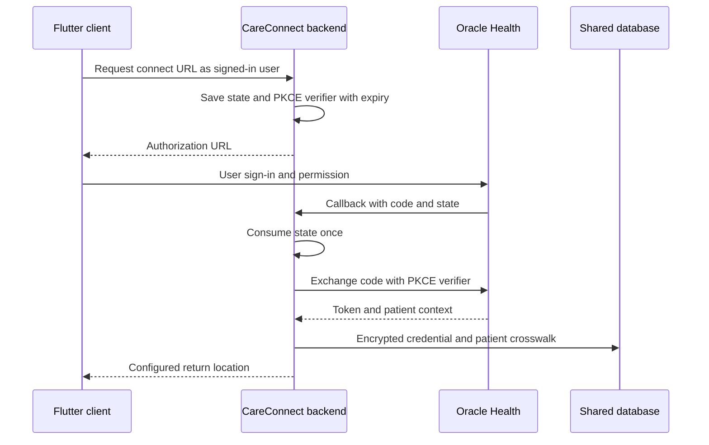
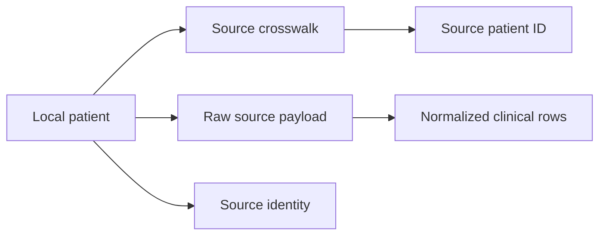

# Team C — Cerner and Localization Technical Design

**Revision:** M4 review edition, October 27, 2026.
**Source baseline:** `team-c-develop` at `d730b752e125cbca09a11c742db66a01b3347cf4`.
**Document status:** Proposed technical design update for team review; approval and release sign-off remain separate.
**Prepared for:** CareConnect, SWEN 670. Team language describes shared system behavior, not individual credit.

This document follows the course TDD template's 18 sections. Code links are pinned to the reviewed commit. “Implemented” means source was inspected. It does not mean deployed, accepted, or tested on this commit. Existing course documents remain intact.

Companion: [Repository technical design](../architecture/CARECONNECT_TECHNICAL_DESIGN_M4.md).

## 1. Introduction
This companion explains Team C's Oracle Health/Cerner record flow and localization work. It gives the team a concrete design to review, test and hand off. It updates older descriptions that lacked backend routes or said unsupported locales could be saved.

The source snapshot now includes Patient/Appointment controller tests and the merged chat share-card client work. A merged change is not a final release acceptance. FHIR is the health-record format; SMART is the app sign-in scheme; PKCE protects the code exchange.

## 2. System Overview
Team C connects a signed-in CareConnect user to an Oracle Health patient context, reads selected FHIR R4 resources, and stores source-linked copies. The vendor flow is retrieval-only. Fetching records still writes local database rows.

Current resource scope: Patient, AllergyIntolerance, Condition, Encounter and provisional Appointment. Localization covers language selection and message catalogs. Final data rules, unified API acceptance and end-to-end proof remain shared work.

## 3. Architecture

Later resource reads resolve a **local patient ID**, check caller access, resolve the source link, obtain a valid token, fetch bounded pages, map the data, and save local copies. Sources: [CernerOAuthService.java](https://github.com/umgc/2026_fall_careconnect/blob/d730b752e125cbca09a11c742db66a01b3347cf4/backend/core/src/main/java/com/careconnect/service/ehr/CernerOAuthService.java), [CernerAuthStateStore.java](https://github.com/umgc/2026_fall_careconnect/blob/d730b752e125cbca09a11c742db66a01b3347cf4/backend/core/src/main/java/com/careconnect/service/ehr/CernerAuthStateStore.java), [CernerPatientLinkService.java](https://github.com/umgc/2026_fall_careconnect/blob/d730b752e125cbca09a11c742db66a01b3347cf4/backend/core/src/main/java/com/careconnect/service/ehr/CernerPatientLinkService.java), [DefaultCernerAccessPolicy.java](https://github.com/umgc/2026_fall_careconnect/blob/d730b752e125cbca09a11c742db66a01b3347cf4/backend/core/src/main/java/com/careconnect/integration/cerner/DefaultCernerAccessPolicy.java), [DefaultCernerPatientAppointmentService.java](https://github.com/umgc/2026_fall_careconnect/blob/d730b752e125cbca09a11c742db66a01b3347cf4/backend/core/src/main/java/com/careconnect/integration/cerner/DefaultCernerPatientAppointmentService.java).

State is currently held in process memory for 600 seconds and consumed once. Restart or a callback to another replica can lose that state. A shared expiring store is a proposed follow-up, not a feature of this baseline.

## 4. Technology Stack
The backend uses Java 17 and Spring Boot 3.4.5. The Flutter client uses generated ARB message resources. FHIR HTTP clients and DTO/mapping services sit behind controllers. JPA entities and SQL provide local persistence. Sources: [pom.xml](https://github.com/umgc/2026_fall_careconnect/blob/d730b752e125cbca09a11c742db66a01b3347cf4/backend/core/pom.xml), [pubspec.yaml](https://github.com/umgc/2026_fall_careconnect/blob/d730b752e125cbca09a11c742db66a01b3347cf4/frontend/pubspec.yaml), [db](https://github.com/umgc/2026_fall_careconnect/blob/d730b752e125cbca09a11c742db66a01b3347cf4/backend/core/src/main/resources/db), [l10n.yaml](https://github.com/umgc/2026_fall_careconnect/blob/d730b752e125cbca09a11c742db66a01b3347cf4/frontend/l10n.yaml).

Public and secure Oracle environments are distinct. Local simulation, public synthetic reads and a full secure sandbox flow must have separate evidence labels.

## 5. Detailed Design of Delivered Features
| Component | Current behavior | Limit |
|---|---|---|
| Connect and callback | Authorization code with PKCE S256; single-use state | Needs secure live evidence and multi-instance state design |
| Token lifecycle | Stores encrypted tokens; refreshes near expiry; marks re-auth needed on failure | Secret rotation and outage behavior need final review |
| Patient linking | Uses SMART patient context and local patient/source crosswalk | No demographic auto-match; conflicting links rejected |
| Patient and Appointment | Controller, service and mapping paths exist | Unified contract remains provisional |
| Conditions and Encounters | Fetch, normalize and store source-linked records | Retention/purge does not cover all new rows |
| Allergies | Maps display data and stores raw payload | No dedicated normalized allergy table in this reviewed path |
| Locale selection | Persists a supported language; rejects unsupported choices | Catalog parity and human quality review still needed |

Sources: [CernerOAuthService.java](https://github.com/umgc/2026_fall_careconnect/blob/d730b752e125cbca09a11c742db66a01b3347cf4/backend/core/src/main/java/com/careconnect/service/ehr/CernerOAuthService.java), [CernerPatientLinkService.java](https://github.com/umgc/2026_fall_careconnect/blob/d730b752e125cbca09a11c742db66a01b3347cf4/backend/core/src/main/java/com/careconnect/service/ehr/CernerPatientLinkService.java), [CernerPatientAppointmentController.java](https://github.com/umgc/2026_fall_careconnect/blob/d730b752e125cbca09a11c742db66a01b3347cf4/backend/core/src/main/java/com/careconnect/integration/cerner/CernerPatientAppointmentController.java), [DefaultCernerConditionEncounterService.java](https://github.com/umgc/2026_fall_careconnect/blob/d730b752e125cbca09a11c742db66a01b3347cf4/backend/core/src/main/java/com/careconnect/integration/cerner/DefaultCernerConditionEncounterService.java), [CernerAllergyController.java](https://github.com/umgc/2026_fall_careconnect/blob/d730b752e125cbca09a11c742db66a01b3347cf4/backend/core/src/main/java/com/careconnect/integration/cerner/CernerAllergyController.java), [locale_provider.dart](https://github.com/umgc/2026_fall_careconnect/blob/d730b752e125cbca09a11c742db66a01b3347cf4/frontend/lib/providers/locale_provider.dart).

The client Health Data list calls Cerner allergies, conditions and encounters when it has a patient ID. It does not call Appointment in that list method. It isolates source failures; any successful response can yield an empty list. The convenience method can hide the difference between total failure and no results. Source: [ehr_data_service.dart](https://github.com/umgc/2026_fall_careconnect/blob/d730b752e125cbca09a11c742db66a01b3347cf4/frontend/lib/features/health/health_data/services/ehr_data_service.dart).

## 6. Interface/API Design
| Method and route | Input / output | Main boundary |
|---|---|---|
| GET `/api/oracle-health/authorize` | Optional launch and return mode; authorization response | Signed-in caller, feature config |
| GET `/api/oracle-health/callback` | Code/state or vendor error; redirect | Single-use state, token exchange, safe configured return |
| GET `/api/oracle-health/status` | Link status | Current caller |
| POST `/api/oracle-health/disconnect` | Disconnect result | Removes credential; does not purge records |
| GET `/v1/api/cerner/patients/{patientId}` | Source and Patient response | Local patient access |
| GET `.../{patientId}/appointments` | Required `start` and `end` Instants; source and appointments | Start before end; external date window |
| GET `.../{patientId}/conditions` | Source and conditions | Patient access, token and provider limits |
| GET `.../{patientId}/encounters` | Source and encounters | Same boundary, resource-specific mapping |
| GET `.../{patientId}/allergies` | Source and allergies | Allergy feature flag and access |

Sources: [CernerOAuthController.java](https://github.com/umgc/2026_fall_careconnect/blob/d730b752e125cbca09a11c742db66a01b3347cf4/backend/core/src/main/java/com/careconnect/controller/CernerOAuthController.java), [CernerPatientAppointmentController.java](https://github.com/umgc/2026_fall_careconnect/blob/d730b752e125cbca09a11c742db66a01b3347cf4/backend/core/src/main/java/com/careconnect/integration/cerner/CernerPatientAppointmentController.java), [CernerClinicalController.java](https://github.com/umgc/2026_fall_careconnect/blob/d730b752e125cbca09a11c742db66a01b3347cf4/backend/core/src/main/java/com/careconnect/integration/cerner/CernerClinicalController.java), [CernerAllergyController.java](https://github.com/umgc/2026_fall_careconnect/blob/d730b752e125cbca09a11c742db66a01b3347cf4/backend/core/src/main/java/com/careconnect/integration/cerner/CernerAllergyController.java). The `...` routes expand to `/v1/api/cerner/patients`.

Example request shape (illustrative, not an executed call): `GET /v1/api/cerner/patients/123/appointments?start=2026-10-01T00:00:00Z&end=2026-11-01T00:00:00Z`. Patient 123 is a placeholder local ID. The source query uses `-date-or-req-period` with lower/upper bounds.

Patient/Appointment controller handling includes 400 for invalid input, 401 for no caller, 403 for denied access, 404 for an unknown patient, 409 for `CERNER_AUTH_EXPIRED`, and 502 for other provider failures. Do not assume every controller has the same error envelope. Freeze the shared OpenAPI contract and error examples before client contract approval.

## 7. Data Design
| Record | Purpose | Key design constraint |
|---|---|---|
| `EhrCredential` | Source token and patient context | User/source identity; encrypt tokens |
| `EhrPatientCrosswalk` | Local patient to source patient link | Patient/source/external identity; reject conflicting links |
| `EhrRawPayload` | Fetched JSON plus metadata | Patient, source, type and external ID; upsert current copy |
| `EhrSourceIdentity` | Source demographics | Keep source identity distinct from canonical Patient |
| `EhrAppointmentRecord` | Times, status, provider/location and other mapped fields | Retain raw linkage and source timestamps |
| `EhrConditionRecord` | Codes, status, dates, precision and encounter references | Preserve partial dates and hidden-active-list state |
| `EhrEncounterRecord` | Normalized encounter data | Retain source and raw linkage |

Source definitions: [ehr](https://github.com/umgc/2026_fall_careconnect/blob/d730b752e125cbca09a11c742db66a01b3347cf4/backend/core/src/main/java/com/careconnect/model/ehr), [db](https://github.com/umgc/2026_fall_careconnect/blob/d730b752e125cbca09a11c742db66a01b3347cf4/backend/core/src/main/resources/db), [DefaultCernerPatientAppointmentService.java](https://github.com/umgc/2026_fall_careconnect/blob/d730b752e125cbca09a11c742db66a01b3347cf4/backend/core/src/main/java/com/careconnect/integration/cerner/DefaultCernerPatientAppointmentService.java), [DefaultCernerConditionEncounterService.java](https://github.com/umgc/2026_fall_careconnect/blob/d730b752e125cbca09a11c742db66a01b3347cf4/backend/core/src/main/java/com/careconnect/integration/cerner/DefaultCernerConditionEncounterService.java).

This is a conceptual link diagram, not a complete physical ERD. Confirm actual SQL constraints before schema changes.

Disconnect deletes the Oracle credential and records an audit event. It does not invoke clinical purge. [EhrSourceDataPurger.java](https://github.com/umgc/2026_fall_careconnect/blob/d730b752e125cbca09a11c742db66a01b3347cf4/backend/core/src/main/java/com/careconnect/service/ehr/EhrSourceDataPurger.java) and [EhrRetentionWorker.java](https://github.com/umgc/2026_fall_careconnect/blob/d730b752e125cbca09a11c742db66a01b3347cf4/backend/core/src/main/java/com/careconnect/service/ehr/EhrRetentionWorker.java) do not list the new Condition, Encounter and Appointment tables as cleanup targets. The team must approve retention, access after disconnect, transaction order, audit retention and raw/normalized lifecycle together. [M4_CONSENT_DISCONNECT_RETENTION_DECISION_BRIEF_2026-10-22.md](https://github.com/umgc/2026_fall_careconnect/blob/d730b752e125cbca09a11c742db66a01b3347cf4/docs/team-c/M4_CONSENT_DISCONNECT_RETENTION_DECISION_BRIEF_2026-10-22.md) records open choices; no new retention period is chosen here.

## 8. UI, Accessibility, and Localization
[oracle_health_connect_tile.dart](https://github.com/umgc/2026_fall_careconnect/blob/d730b752e125cbca09a11c742db66a01b3347cf4/frontend/lib/widgets/oracle_health_connect_tile.dart) provides the connect surface. [oracle_health_issuer.dart](https://github.com/umgc/2026_fall_careconnect/blob/d730b752e125cbca09a11c742db66a01b3347cf4/frontend/lib/services/oracle_health_issuer.dart) requires the configured and launch issuer URLs to match and checks secure URL shape. Launch/return navigation and source records must be tested as one user flow.

[locale_provider.dart](https://github.com/umgc/2026_fall_careconnect/blob/d730b752e125cbca09a11c742db66a01b3347cf4/frontend/lib/providers/locale_provider.dart) uses `selected_locale` in local preferences. It normalizes language input and uses supported locales to reject invalid choices. Clearing a choice removes it. The current choice model uses language codes, not regional variants.

A new unique-key scan of [l10n](https://github.com/umgc/2026_fall_careconnect/blob/d730b752e125cbca09a11c742db66a01b3347cf4/frontend/lib/l10n) found:

| Catalog group | Unique keys | Missing vs English | Extra vs English |
|---|---:|---:|---:|
| English | 1,335 | 0 | 0 |
| Spanish | 1,314 | 21 | 0 |
| am, ar, bn, fa, fr, hi, ja, ne, pt, ru, zh | 948 each | 387 each | 0 |
| Urdu | 949 | 387 | 1 |

Metadata keys beginning with `@` are excluded. Key counts do not measure text accuracy or whether English text remains in a translation. Generated fallback can mask gaps. Use [l10n.yaml](https://github.com/umgc/2026_fall_careconnect/blob/d730b752e125cbca09a11c742db66a01b3347cf4/frontend/l10n.yaml) for generation, then review placeholders, plural forms, text expansion, RTL, screen-reader names and supported device sizes.

## 9. External Integrations
[CernerProperties.java](https://github.com/umgc/2026_fall_careconnect/blob/d730b752e125cbca09a11c742db66a01b3347cf4/backend/core/src/main/java/com/careconnect/config/CernerProperties.java) defines source configuration. Master and resource flags default to false. Relevant variables include `CARECONNECT_CERNER_ENABLED`, `CARECONNECT_CERNER_ALLERGIES_ENABLED`, `CARECONNECT_CERNER_CLINICAL_ENABLED`, and `CARECONNECT_CERNER_PATIENT_APPOINTMENT_ENABLED`.

`CERNER_FHIR_BASE_URL`, `CERNER_CLIENT_ID`, `CERNER_REDIRECT_URI` and scopes must match the registered app. A confidential client also uses a secret. Authorization/token endpoints can be configured or discovered. Keep values out of reports.

The default callback points to port 8081 while the backend's default port is 8080. Configure an exact registered, reachable callback for the chosen environment; do not copy defaults blindly. Sources: [CernerProperties.java](https://github.com/umgc/2026_fall_careconnect/blob/d730b752e125cbca09a11c742db66a01b3347cf4/backend/core/src/main/java/com/careconnect/config/CernerProperties.java), [application.properties](https://github.com/umgc/2026_fall_careconnect/blob/d730b752e125cbca09a11c742db66a01b3347cf4/backend/core/src/main/resources/application.properties).

[CernerFhirBundleHttpClient.java](https://github.com/umgc/2026_fall_careconnect/blob/d730b752e125cbca09a11c742db66a01b3347cf4/backend/core/src/main/java/com/careconnect/integration/cerner/CernerFhirBundleHttpClient.java) and [CernerAllergyHttpClient.java](https://github.com/umgc/2026_fall_careconnect/blob/d730b752e125cbca09a11c742db66a01b3347cf4/backend/core/src/main/java/com/careconnect/integration/cerner/CernerAllergyHttpClient.java) restrict trusted paging, reject cycles, and bound requests: default timeout 10 seconds, maximum configured timeout 30 seconds, response limit 1,048,576 bytes per response and maximum 20 pages. HTTP is limited to local exceptions; secure external URLs are expected. Redirects and next links must not allow an untrusted host. Incomplete paging must not silently become a complete result.

## 10. AI/ML Design
Team C does not add a new model here. Shared AI may consume permitted source records through the common retrieval and consent path. A fetched Cerner record is not permission for AI use or for sharing with another person. Validate allowed source scope, record access, audit linkage and revocation against the shared AI design. Sources: [AiAskService.java](https://github.com/umgc/2026_fall_careconnect/blob/d730b752e125cbca09a11c742db66a01b3347cf4/backend/core/src/main/java/com/careconnect/service/ai/ask/AiAskService.java), [ConsentService.java](https://github.com/umgc/2026_fall_careconnect/blob/d730b752e125cbca09a11c742db66a01b3347cf4/backend/core/src/main/java/com/careconnect/service/consent/ConsentService.java).

## 11. Security and Privacy
The backend resolves the caller, maps the local patient to its user, and calls the shared patient-access check. A FHIR patient ID is not a valid substitute for the local route ID. Source: [DefaultCernerAccessPolicy.java](https://github.com/umgc/2026_fall_careconnect/blob/d730b752e125cbca09a11c742db66a01b3347cf4/backend/core/src/main/java/com/careconnect/integration/cerner/DefaultCernerAccessPolicy.java).

[TokenCryptor.java](https://github.com/umgc/2026_fall_careconnect/blob/d730b752e125cbca09a11c742db66a01b3347cf4/backend/core/src/main/java/com/careconnect/security/TokenCryptor.java) encrypts tokens with AES-GCM, a random IV and a versioned payload. The key derives from `email.crypto.secret`; managed key rotation is not established by this code. Never expose codes, access/refresh tokens or real patient records in tests or screenshots.

The current relationship guard is not a one-record grant. Chat share cards are a separate client feature. The CR-2 consent/record identifier/lifecycle policy still needs review before it can be claimed as implemented. Use [M4_CONSENT_DISCONNECT_RETENTION_DECISION_BRIEF_2026-10-22.md](https://github.com/umgc/2026_fall_careconnect/blob/d730b752e125cbca09a11c742db66a01b3347cf4/docs/team-c/M4_CONSENT_DISCONNECT_RETENTION_DECISION_BRIEF_2026-10-22.md) for the open decision set.

## 12. Error Handling, Logging, and Observability
Distinguish bad input, denied access, expired source credentials, no records, timeout and partial-source failure. The UI should not tell a user “no records” when the provider is unavailable.

Preserve safe source labels and request/audit references. Log lifecycle outcomes without token or payload bodies. Review fail-soft audit behavior and required alerting. Token refresh failures should lead to a clear reconnect path, not an endless retry loop. Sources: [CernerOAuthService.java](https://github.com/umgc/2026_fall_careconnect/blob/d730b752e125cbca09a11c742db66a01b3347cf4/backend/core/src/main/java/com/careconnect/service/ehr/CernerOAuthService.java), [CernerPatientAppointmentController.java](https://github.com/umgc/2026_fall_careconnect/blob/d730b752e125cbca09a11c742db66a01b3347cf4/backend/core/src/main/java/com/careconnect/integration/cerner/CernerPatientAppointmentController.java), [ehr_data_service.dart](https://github.com/umgc/2026_fall_careconnect/blob/d730b752e125cbca09a11c742db66a01b3347cf4/frontend/lib/features/health/health_data/services/ehr_data_service.dart).

## 13. Performance, Scalability, and Reliability
Page/byte/time limits bound provider calls but do not prove acceptable load performance. Plan tests at limit boundaries, repeated pages, a slow server, a bad next link and a refresh failure. Verify that a failed fetch does not publish a partial complete result.

Before multiple replicas, move OAuth state to an approved shared expiring store or approve and test another routing design. Before large refresh jobs, measure request rate, source throttling, database writes and duplicate/upsert behavior. No load or failover claim is made here.

## 14. Design for Testability
| Area | Existing source | What remains to prove |
|---|---|---|
| OAuth/state | [CernerOAuthServiceTest.java](https://github.com/umgc/2026_fall_careconnect/blob/d730b752e125cbca09a11c742db66a01b3347cf4/backend/core/src/test/java/com/careconnect/service/ehr/CernerOAuthServiceTest.java) | Secure sign-in, refresh, expiry/reconnect and callback routing |
| Patient/Appointment API | [CernerPatientAppointmentControllerTest.java](https://github.com/umgc/2026_fall_careconnect/blob/d730b752e125cbca09a11c742db66a01b3347cf4/backend/core/src/test/java/com/careconnect/integration/cerner/CernerPatientAppointmentControllerTest.java) | Approved schema and integrated client behavior |
| Conditions/Encounters | [CernerConditionEncounterWireMockIntegrationTest.java](https://github.com/umgc/2026_fall_careconnect/blob/d730b752e125cbca09a11c742db66a01b3347cf4/backend/core/src/test/java/com/careconnect/integration/cerner/CernerConditionEncounterWireMockIntegrationTest.java) | Final contract and live synthetic resource checks |
| HTTP safety | [CernerFhirBundleHttpClientTest.java](https://github.com/umgc/2026_fall_careconnect/blob/d730b752e125cbca09a11c742db66a01b3347cf4/backend/core/src/test/java/com/careconnect/integration/cerner/CernerFhirBundleHttpClientTest.java) | Agreed limit and failure cases on final candidate |
| Database schema | [EhrCanonicalSchemaPostgresTest.java](https://github.com/umgc/2026_fall_careconnect/blob/d730b752e125cbca09a11c742db66a01b3347cf4/backend/core/src/test/java/com/careconnect/repository/ehr/EhrCanonicalSchemaPostgresTest.java) | All normalized lifecycle and purge paths |
| Locale selection | [locale_provider_test.dart](https://github.com/umgc/2026_fall_careconnect/blob/d730b752e125cbca09a11c742db66a01b3347cf4/frontend/test/providers/locale_provider_test.dart) | Translation quality, RTL and accessibility |
| Launch UI | [oracle_health_launch_page_test.dart](https://github.com/umgc/2026_fall_careconnect/blob/d730b752e125cbca09a11c742db66a01b3347cf4/frontend/test/pages/oracle_health_launch_page_test.dart) | Complete registered-app browser flow |

The repository [m4-test-summary.md](https://github.com/umgc/2026_fall_careconnect/blob/d730b752e125cbca09a11c742db66a01b3347cf4/docs/testing/m4-test-summary.md) remains **Not Run**, not a passing final report. Test files now exist for areas whose old status rows lack them; update execution rows only after running them on a frozen candidate.

Historical PR #429 source `ee5ce3963209a5d10301bdd34b2ef8b960673ba1` passed local clean verification: 8,509 total, 8,431 passed, 78 skipped, zero failures/errors. Both GitHub checks passed, but the PR was still open on October 27. Those results are not tests of `d730b752`.

Earlier public synthetic sandbox probes returned Patient, Allergy and Encounter data. The Encounter next page was not followed. Condition timed out; corrected Appointment date filtering returned an empty successful result. Secure discovery worked and an unauthenticated secure Patient request returned 401. This proves limited endpoint reachability, not secure login, token refresh or an app end-to-end run.

Required final evidence: one candidate SHA; exact configuration and tool versions; backend and frontend reports; contract checksum; PostgreSQL results; skipped/blocked cases; secure synthetic login/read/refresh/disconnect proof; localization and access review; QA approval. No application tests were rerun for these documentation changes.

## 15. Deployment, Environments, and Operations
Keep features disabled until registration, callback, scopes, patient mapping and access rules are confirmed. Run schema checks on the actual database engine. Inject secrets through the approved environment path. Confirm a real signed-in synthetic user before accepting live integration.

For a release: record branch/SHA → agree contract and policy → test candidate → review defects → approve deployment → smoke test → record rollback steps. Disconnect and purge are separate operations until policy says otherwise. Do not run destructive cleanup as a smoke test.

## 16. Traceability
| Scope / document ID | Current design or evidence | Remaining gate |
|---|---|---|
| WBS 4.2–4.5 historical l10n and SMART scope | Catalogs, locale provider, PKCE and resource work exist | Do not infer milestone completion from code alone |
| WBS 4.2.9–11, decision brief scope | Storage/consent/disconnect review documented | Shared rules and ownership approval |
| WBS 4.5.4 / 4.5.6 handoff checks referenced by brief | QA template and evidence plan exist | Frozen-candidate execution and sign-off |
| TC-D01 source mapping | [DefaultCernerPatientAppointmentService.java](https://github.com/umgc/2026_fall_careconnect/blob/d730b752e125cbca09a11c742db66a01b3347cf4/backend/core/src/main/java/com/careconnect/integration/cerner/DefaultCernerPatientAppointmentService.java), [DefaultCernerConditionEncounterService.java](https://github.com/umgc/2026_fall_careconnect/blob/d730b752e125cbca09a11c742db66a01b3347cf4/backend/core/src/main/java/com/careconnect/integration/cerner/DefaultCernerConditionEncounterService.java), [ehr](https://github.com/umgc/2026_fall_careconnect/blob/d730b752e125cbca09a11c742db66a01b3347cf4/backend/core/src/main/java/com/careconnect/model/ehr) | Approved field, date and identity rules |
| TC-D02 access/lifecycle | [DefaultCernerAccessPolicy.java](https://github.com/umgc/2026_fall_careconnect/blob/d730b752e125cbca09a11c742db66a01b3347cf4/backend/core/src/main/java/com/careconnect/integration/cerner/DefaultCernerAccessPolicy.java), [EhrSourceDataPurger.java](https://github.com/umgc/2026_fall_careconnect/blob/d730b752e125cbca09a11c742db66a01b3347cf4/backend/core/src/main/java/com/careconnect/service/ehr/EhrSourceDataPurger.java), [EhrRetentionWorker.java](https://github.com/umgc/2026_fall_careconnect/blob/d730b752e125cbca09a11c742db66a01b3347cf4/backend/core/src/main/java/com/careconnect/service/ehr/EhrRetentionWorker.java) | Consent, retention and deletion acceptance |
| TC-D03 localization | [locale_provider.dart](https://github.com/umgc/2026_fall_careconnect/blob/d730b752e125cbca09a11c742db66a01b3347cf4/frontend/lib/providers/locale_provider.dart), [l10n](https://github.com/umgc/2026_fall_careconnect/blob/d730b752e125cbca09a11c742db66a01b3347cf4/frontend/lib/l10n) | Catalog and human workflow completion |
| TC-D04 secure integration | [CernerOAuthService.java](https://github.com/umgc/2026_fall_careconnect/blob/d730b752e125cbca09a11c742db66a01b3347cf4/backend/core/src/main/java/com/careconnect/service/ehr/CernerOAuthService.java), [CernerFhirBundleHttpClient.java](https://github.com/umgc/2026_fall_careconnect/blob/d730b752e125cbca09a11c742db66a01b3347cf4/backend/core/src/main/java/com/careconnect/integration/cerner/CernerFhirBundleHttpClient.java) | Secure sandbox and app evidence |

TC-D IDs are local design IDs, not WBS tasks or approved SRS identifiers. No WBS percentage, assignment, labor entry or completion date was changed. The approved workbook remains the authority for exact task naming and credit.

## 17. Issues, Limitations, and Technical Debt
| Priority | Open work | Proposed reviewer / completion proof |
|---|---|---|
| High | Agree source fields, dates, conflicts and output contract | Technical Architect and API owners; signed rules/schema |
| High | Agree disconnect, retained access and purge behavior | Shared architecture/Team Lead; policy plus database tests |
| High | Run final tests on one merged version | Tiffany/QA coordination; exact-SHA results and defect review |
| High | Prove secure Cerner app flow | Integration owner and QA; sanitized synthetic evidence |
| Medium | Connect Appointment to the intended client journey | Frontend/API owners; contract and UI test |
| Medium | Close 21 Spanish and 387-per-other-catalog gaps | Localization owners; parity scan and qualified review |
| Medium | Separate unavailable data from empty data | Client/API owners; clear result contract and tests |
| Medium | Replace or govern process-local OAuth state | Backend/operations; restart and multi-replica test |

Technical Architect next actions: finish the field/access/lifecycle decision table, obtain shared review, pin the API schema, and use a single candidate/evidence manifest for handoff. These are proposed next steps, not claims that approval occurred.

## 18. Design Decision Log
| Decision | State | Reason |
|---|---|---|
| Separate local identity from vendor identity | Implemented | Prevents a source ID from becoming an authorization key |
| Use authorization code plus PKCE | Implemented | Binds code exchange to the initiating flow |
| Keep raw source copies and mapped records | Implemented | Supports source trace and application use; lifecycle unresolved |
| Reject unsupported locale selection | Implemented | Prevents an invalid saved language choice |
| Use per-source UI failure isolation | Implemented with limitation | Partial records can render; failure vs empty needs clarity |
| Approve final data, consent and cleanup rules | Pending | Cross-team impact requires explicit review |
| Accept secure sandbox and release evidence | Pending | Public reads and earlier tests are insufficient |

### Review provenance
AI-assisted drafting used repository source and saved test evidence. Human review is required before design acceptance. This update changes documentation only and leaves historical TDD files intact.
